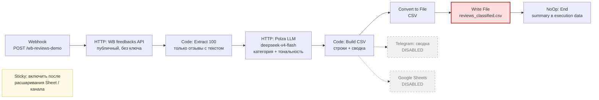

# Agent Hub + Code Mode: безопасная автоматизация n8n через LLM-агента

> Кейс: 100 реальных отзывов Wildberries → классификация LLM → CSV за **8.1 секунду**, с 5 итерациями автономного ремонта.

## Проблема

Ручной анализ отзывов — 2+ часа на сотню. Существующие «боты-парсеры» — one-shot скрипты без контроля, безопасности и аудита: запустил и молись.

## Решение — Agent Hub

Агент не пишет скрипты «вслепую» — он ведёт управляемый процесс:

```
интервью → бриф (read-only ресёрч) → явное «да» человека
  → sandbox-исполнение через Code Mode → аудит по факту → память
```

- **Интервью**: агент не угадывает задачу — задаёт вопросы (источник, формат, критерии приёмки).
- **Бриф**: до старта — только read-only проверки (поиск, GET). Любые мутации запрещены до подтверждения.
- **Confirm-гейт**: ничего не создаётся, не удаляется и не отправляется без явного «да» пользователя.
- **Аудит**: результат проверяется по критериям брифа по факту (файл перечитывается, цифры — из данных).
- **Память**: бриф, решения и итог сохраняются — следующая задача не начинается с нуля.

Это не one-shot скрипт, а воспроизводимый процесс с человеческим контролем на каждом опасном шаге.

## Code Mode MCP — главная фича

Один MCP-сервер, два инструмента — вместо сотен перегружающих контекст:

- **`search(query)`** — агент находит нужные методы по каталогу скиллов: получает полные сигнатуры (параметры, типы, required, danger-уровень).
- **`execute(js_code, confirm)`** — исполняет JS-цепочку вызовов в sandbox (`node:vm`): без `require`/`process`/`fetch`, HTTP — только через адаптеры серверов. Последовательные `await` и `Promise.all()` без обращений к LLM между вызовами.

Безопасность на уровне сервера:

- **Confirm-гейт**: write/delete-методы без `confirm=true` → `confirmation_required`, код НЕ исполняется.
- **`setNodeCode`** — сервер читает код ноды из файла, минуя пересборку моделью (см. итерацию ремонта №3 — решает реальную проблему порчи JS-экранирования при `updateWorkflow`).
- Каждый вызов логируется (хэш кода, методы, статусы, длительность).

Масштабируемость: новая интеграция = +методы в `registry.json` + 1 строка в каталоге скиллов. Инструментов всегда 2. Контекст агента не растёт.

## Кейс: WB-отзывы

- **Товар**: nmId=165462535 («Бандана хлопковая»), 10 611 отзывов, взято 100 с текстом.
- **Результат**: 8.1 сек, 100/100 строк с текстом: **похвала 76 / вопрос 24 / жалоба 0**.



**Легенда:** сплошные стрелки — активный путь (как исполнялся демо-прогон); пунктир — отключённые ветки (ноды Telegram и Google Sheets в демо не соединены с графом, включаются без изменения логики); красным выделен узел записи на диск (danger-действие — в конвейере Agent Hub проходит через confirm-гейт).

### 5 итераций ремонта (честно, с первопричинами)

| # | Первопричина | Решение |
|---|---|---|
| 1 | Легаси OpenAI-креды n8n мертвы (401/404) | Переход на Polza HTTP-ноду |
| 2 | Polza-нода без Authorization → 401 | Заголовок Bearer добавлен |
| 3 | LLM ломает JS-экранирование при `updateWorkflow` (`"` → `"""`) | Создан `setNodeCode`: код ноды читается из файла сервером |
| 4 | n8n запрещал запись CSV наружу | `N8N_RESTRICT_FILE_ACCESS_TO` |
| 5 | HTTP-нода затирала поля отзыва своим ответом (LLM классифицировал пустые строки) | Item linking: джоин по индексу с `$('Extract 100')` |

Каждая итерация — реальный диагноз из логов, а не перебор. Итог: конвейер «аудит → ремонт → перепроверка» работает в бою.

## Ядро

Демо построено на [agent-hub-core-mcp](https://github.com/nekto9852-bit/agent-hub-core-mcp) — Code Mode MCP + конвейер агента + безопасность.

## Стек

Hermes Agent (Python) · Code Mode MCP (Node.js, `@modelcontextprotocol/sdk`) · n8n 2.44 · Polza (deepseek-v4-flash) · Google Sheets (отключено) · Telegram (отключено)

## Как запустить

```bash
# 1. Клонировать репо
git clone https://github.com/nekto9852-bit/agent-hub-code-mode.git

# 2. Поднять n8n и импортировать workflow/wb-reviews-demo.json
# 3. Настроить Polza-ключ в .env ноды LLM Classify (POLZA_API_KEY)
# 4. Запустить:
curl -X POST http://localhost:5678/webhook/wb-reviews-demo
# Результат: data/reviews_classified.csv + метрики в metrics.json
```

## Честные оговорки

- Baseline «2ч вручную» — экспертная оценка (estimate), не замер.
- Sheets/Telegram — отключены в демо; включаются расшариванием Sheet / настройкой канала без изменения логики.
- Ключи и токены не хранятся в репо; в export-JSON Workflow секреты вычищены.
- Классификация — flash-модель: часть «вопросов» спорна; для продакшена — few-shot промпт или модель классом выше.

## Структура

```
├── README.md                  ← этот файл
├── LICENSE                    ← MIT
├── metrics.json               ← замеры и распределения
├── data/
│   └── reviews_classified.csv ← 100 отзывов с классификацией
└── workflow/
    └── wb-reviews-demo.json   ← n8n workflow (11 узлов, секреты вычищены)
```

## Лицензия

MIT — см. [LICENSE](LICENSE).
